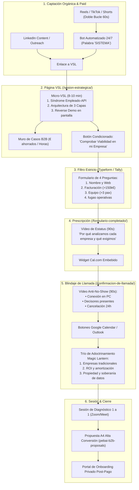

# PEBAI Sales Funnel Engine — Framework Maestro de Embudos High-Ticket B2B

Este documento condensa los estándares de ingeniería de conversión, copywriting de respuesta directa y arquitectura de embudos para **PEBAI Systems** (`pebaisystems.es`). Combina los marcos internacionales más reconocidos con el análisis exhaustivo de la competencia nacional e internacional.

---

## 1. LOS 5 FRAMEWORKS MAESTROS INTEGRADOS

### 1.1 El Método RMBC (Stefan Georgi / Cole Schaffer)
* **Research (Investigación):** Identificación milimétrica de las fugas de capital y dolores operativos del CEO/COO.
* **Mechanism (El Mecanismo Único):**
  * *Mecanismo del Problema:* **«El Síndrome del Empleado-API»** (usar talento cualificado de 2.000 €/mes para mover manualmente datos entre un CRM, un Excel y un correo) y **«La Fuga del Lead Frío»** (tardar horas en contestar y perder el 60% de las ventas).
  * *Mecanismo de la Solución:* **«El Sistema Operativo de Procesos e IA de 3 Capas»** (Capa 1: Auditoría de Flujos, Capa 2: Conectores e Infraestructura Robusta, Capa 3: Agentes de Voz y WhatsApp 24/7).
* **Brief:** Decisores en empresas con facturación recurrente (>150k€/año) y equipo (>3 personas).
* **Copy:** Redacción sobria, matemática, des-robotizada y con pruebas empíricas.

### 1.2 Cole Gordon (Closers.io / 7-Figure Agency Funnels)
* **The Micro-VSL (7-12 min):** Directa al mecanismo y a la demostración técnica, sin preámbulos teóricos.
* **The "Hold The Line" Pre-Call Protocol:** Vídeo de prescripción que eleva el estatus de la consultora antes de que el lead agende.
* **2-Way WhatsApp Verification:** Confirmación bidireccional por mensaje de texto/WhatsApp para reducir el no-show por debajo del 8%.
* **The Indoctrination Homework:** Tareas previas obligatorias para el prospecto antes de la llamada.

### 1.3 Sabri Suby (King Kong / Sell Like Crazy)
* **The Godfather Offer (Oferta Irresistible B2B):** Auditoría Operativa 0 € con garantía de entrega de un mapa técnico de arquitectura en 30 minutos.
* **The Magic Lantern Technique:** Secuencia de adoctrinamiento pre-llamada donde cada micro-vídeo elimina una objeción de raíz y acerca al prospecto al cierre antes de empezar la sesión.

### 1.4 Liam Ottley (Morningside AI) & Veloce (The Reverse Demo Model)
* **Discovery-First Positioning:** No vender una solución enlatada, sino una sesión técnica de diagnóstico.
* **Behind-The-Scenes Tech Proof:** Mostrar la consola, los nodos de automatización y las llamadas reales de los agentes en pantalla durante la VSL para aniquilar cualquier sospecha de "humo".

### 1.5 Revolutia.ai & Adilet (The Private Vault Model)
* **El Disparador de Alta Conversión en Redes:** No pedir a un CEO que "reserve una llamada" en un comentario de Reel. Pedir que comente **`SISTEMA`** o **`BÓVEDA`** para recibir el diagrama técnico o el acceso a la infraestructura privada.

---

## 2. BENCHMARK COMPETITIVO: MODELOS EN ESPAÑA Y EL MUNDO

| Competidor / Referente | Modelo de Embudo | Puntos Fuertes | Debilidades / Dónde Gana PEBAI |
| :--- | :--- | :--- | :--- |
| **Fran García Cars** | VSL -> Typeform -> Prescripción -> Calendario -> Confirmación -> Gracias | • Excelente ritmo audiovisual y prueba social. • Botón con smart delay. • Identidad sobria y limpia. | • Embudo B2C/físico: no aborda objeciones técnicas B2B. • Demasiadas páginas dispersas (5 URLs). • La página de Gracias diluye la conversión. |
| **Revolutia.ai** | Redes (Ganchos de impacto) -> Bot DM -> Entrega de Bóveda / Skool -> Aplicación a IA Pro o Agencia | • Disparador de comentarios brutalmente optimizado. • Comunidad y autorizaciones de Skool. | • Muy enfocado en infoproducción/formación para principiantes. • Las empresas consolidadas perciben el modelo Bóveda/Skool como "para novatos". PEBAI gana en seriedad corporativa y consultoría ejecutiva. |
| **Morningside AI (Liam Ottley)** | YouTube Orgánico -> Micro-VSL Técnica -> Formulario con filtro de presupuesto ($10k+) -> Discovery Call | • Muestra código y diagramas reales. • Posicionamiento premium internacional. • Filtro estricto de clientes. | • Enfocado a mercado anglosajón. • Ausencia de embudo de respuesta inmediata local en España y WhatsApp. |
| **SolucionIA / Vega Consultores** | Web corporativa clásica -> Formulario de contacto tradicional -> Llamada comercial | • Experiencia en procesos locales. • Conexión con ERPs españoles. | • Embudos analógicos y lentos: no tienen VSL moderna, no educan al prospecto previamente y sufren de altos ratios de no-show y llamadas no cualificadas. |

---

## 3. LA ARQUITECTURA HÍBRIDA GANADORA PEBAI 2026

