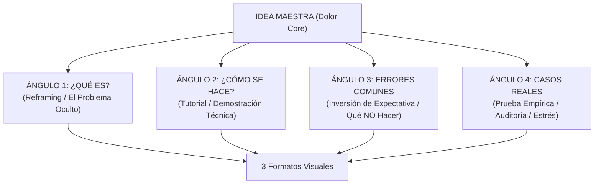
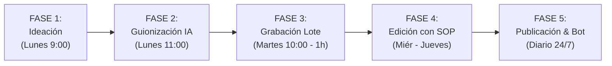

# SISTEMA MAESTRO DE ADQUISICIÓN Y CONTENIDO B2B — PEBAI SYSTEMS

> **Documento Oficial de Estrategia, Producción Industrial y Conversión Orgánica**  
> *Versión 2.0 — Actualizado y ampliado con ingeniería inversa de creadores de alto impacto (@mich.markeeting, @thejordisegues, @matejimenez_)*  
> *Objetivo: Escalar la captación de clientes B2B mediante contenido corto (Shorts, Reels, TikTok) sin improvisación y con un flujo automatizado de cualificación.*

---

## 1. MISIÓN Y PRINCIPIOS ESTRATÉGICOS

El contenido en redes de **PEBAI Systems** no tiene como fin el entretenimiento ni la viralidad vacía. Su único propósito es operar como un **embudo industrial de captación B2B**:

1. **Hacer visible un dolor financiero u operativo:** Exponer con cifras concretas la pérdida de ventas, el desperdicio de horas del equipo y la lentitud ante la competencia.
2. **Posicionar a PEBAI como la autoridad técnica de referencia:** Demostrar que entendemos la arquitectura empresarial, los procesos reales y la inteligencia artificial aplicada (sin clichés ni humo).
3. **Provocar una acción privada de alta cualificación:** Cada pieza conduce a una solicitud privada en `https://pebaisystems.es/diagnostico/` mediante palabras clave automatizadas por nuestro bot 24/7.
4. **Separar radicalmente la creación de contenido del caos diario:** Aplicar la filosofía interna de PEBAI: *«Los procesos son lo único que te diferencia a ti de una marca con cientos de miles de seguidores y un flujo predecible de clientes»*.

---

## 2. INGENIERÍA INVERSA: AUDITORÍA DE REFERENTES GANADORES

Analizamos y extraemos las mecánicas exactas de retención y conversión de los referentes más virales del sector para incorporarlas al ADN de PEBAI:

```
┌────────────────────────────────────────────────────────────────────────────────────────────────┐
│                              MATRIZ DE REFERENTES AUDITADOS                                    │
├─────────────────────┬───────────────────┬──────────────────────────────────────────────────────┤
│ Creador             │ Métricas Clave    │ Mecánica / Aprendizaje Extraído                      │
├─────────────────────┼───────────────────┼──────────────────────────────────────────────────────┤
│ @mich.markeeting    │ 663K views        │ Meta-Hook Negativo & Polarización:                   │
│                     │ 31K guardados     │ "Nunca hagas X sin antes hacer Y". Inversión de      │
│                     │                   │ expectativa en los primeros 3 segundos.              │
├─────────────────────┼───────────────────┼──────────────────────────────────────────────────────┤
│ @thejordisegues     │ 763K views        │ 10 Fórmulas de Hook en 33 segundos:                  │
│                     │ 37K guardados     │ Ritmo vertiginoso, cortes limpios de 2-3s,           │
│                     │                   │ promesa hiperbólica controlada ("Nadie te dice esto")│
├─────────────────────┼───────────────────┼──────────────────────────────────────────────────────┤
│ @matejimenez_ (V1)  │ 28.5K views       │ Las 5 Skills de IA para Contenido:                   │
│                     │ 2.000 guardados   │ Sistema de prompts encadenados (Ideación -> Guion -> │
│                     │ 669 comentarios   │ Variantes -> Calendario -> Lead Magnet).             │
├─────────────────────┼───────────────────┼──────────────────────────────────────────────────────┤
│ @matejimenez_ (V2)  │ 4.040 views       │ La Fórmula Multiplicadora 5 × 4 × 3 = 60 Vídeos:     │
│                     │ 265 guardados     │ 5 Ideas Base × 4 Ángulos × 3 Formatos Visuales.      │
│                     │ 77 comentarios    │ Jamás buscar ideas desde cero cada día.              │
├─────────────────────┼───────────────────┼──────────────────────────────────────────────────────┤
│ @matejimenez_ (V3)  │ 1.083 views       │ El Sistema Industrial de Producción en 5 Fases:      │
│                     │ 53 guardados      │ Ideación -> Guionización IA -> Batching (1h/semana)  │
│                     │ 13 comentarios    │ -> Edición asíncrona con SOP -> Publicación & Test.  │
└─────────────────────┴───────────────────┴──────────────────────────────────────────────────────┘
```

---

## 3. LA MATRIZ MULTIPLICADORA PEBAI: 5 IDEAS × 4 ÁNGULOS × 3 FORMATOS = 60 PIEZAS / MES

El mayor error de los fundadores es creer que necesitan 60 ideas nuevas al mes. La clave está en **multiplicar los 5 dolores core de las empresas en 4 ángulos psicológicos y 3 formatos de presentación**, generando **60 impactos únicos con solo 5 conceptos base**.

### Las 5 Ideas Maestras (Dolores Core B2B)
1. **Idea 1 (Operativa y Costes):** El coste invisible de las tareas manuales y la pérdida de horas en tareas repetitivas (Excel, correos, facturación).
2. **Idea 2 (Ventas y Respuesta Inmediata):** Clientes que escriben por WhatsApp o llaman y se van a la competencia por tardar minutos en responder.
3. **Idea 3 (Visibilidad GEO):** La invisibilidad de la empresa ante los nuevos buscadores de IA (ChatGPT, Perplexity, Gemini).
4. **Idea 4 (Productividad de Equipos):** La brecha interna de productividad: empresas que pagan licencias de IA pero sus empleados no saben integrarlas en sus procesos reales.
5. **Idea 5 (Fragilidad Operativa y Sistemas):** La empresa que depende de una sola persona o de una hoja de cálculo frágil para no colapsar.

---

### Los 4 Ángulos Psicológicos por Idea

Cada dolor se aborda desde 4 perspectivas psicológicas que conectan con diferentes estados de consciencia del cliente:



1. **Ángulo 1: ¿Qué es? (El Despertar / Reframing B2B):**
   * *Objetivo:* Cambiar la percepción del problema. No es un fallo menor, es una fuga de capital.
   * *Ejemplo:* «No necesitas contratar a otro administrativo: necesitas un sistema que elimine el 40% de tareas invisibles que no facturan un euro.»
2. **Ángulo 2: ¿Cómo se hace? (El Método / Arquitectura):**
   * *Objetivo:* Enseñar el mecanismo técnico sin tecnicismos baratos, transmitiendo solvencia de ingeniería.
   * *Ejemplo:* «Así es como conectamos un agente de WhatsApp con el CRM y la base de datos para responder presupuestos en 18 segundos.»
3. **Ángulo 3: Errores Comunes (Inversión de Expectativa):**
   * *Objetivo:* Desmontar lo que la mayoría hace mal para posicionar a PEBAI como la alternativa seria.
   * *Ejemplo:* «Intentar automatizarlo todo sin auditar tus procesos es el camino más rápido para colapsar tu empresa a doble de velocidad.»
4. **Ángulo 4: Casos Reales y Pruebas de Estrés (Evidencia Indiscutible):**
   * *Objetivo:* Presentar situaciones reales de empresas, antes y después, o pruebas en directo.
   * *Ejemplo:* «Facturaban 1 millón de euros y gestionaban entregas en un Excel lleno de parches hasta que se corrompió un lunes por la mañana.»

---

### Los 3 Formatos de Presentación Visual

Cada combinación de Idea y Ángulo se puede ejecutar en 3 formatos de grabación distintos:

* **Formato A — Autoridad Ejecutiva (Talking Head en Estudio):**
  * Fundador en plano medio o primer plano, mesa limpia, fondo neutro o blanco, iluminación de tres puntos.
  * Tono pausado, sobrio, formal. Rótulos de apoyo cada 3 segundos.
  * *Uso principal:* Vídeos BOFU y de reputación de marca.
* **Formato B — Demostración Técnica en Pantalla (Screen Share & Whiteboard / Miro):**
  * Cámara en ventana circular o lateral + grabación de pantalla mostrando un tablero de Miro, Make, un CRM o un flujo de datos.
  * Trazado visual en directo con cursor destacado.
  * *Uso principal:* Vídeos MOFU para convertir curiosidad en confianza ciega.
* **Formato C — Dinámico & Listicle / Top de Herramientas (TOFU de Alto Alcance):**
  * Ritmo más rápido, cortes dinámicos, capturas de herramientas en funcionamiento, pruebas de estrés en vivo con cronómetro.
  * *Uso principal:* Captura de tráfico frío masivo en TikTok, Reels y Shorts.

$$\text{5 Ideas Maestras} \times \text{4 Ángulos Psicológicos} \times \text{3 Formatos Visuales} = \mathbf{60\text{ Vídeos Producibles}}$$

---

## 4. LAS 5 SKILLS OPERATIVAS DE IA PARA PEBAI SYSTEMS

Adaptamos el framework de Skills de IA para estructurar el departamento de marketing y contenidos de PEBAI en 5 agentes/prompts especializados:

```
┌────────────────────────────────────────────────────────────────────────────────────────┐
│                        FLUJO DE LAS 5 SKILLS OPERATIVAS DE IA                          │
├────────────────────────────────────────────────────────────────────────────────────────┤
│  [SKILL 1] Radar de Inteligencia & Benchmarking                                       │
│       │    Analiza cuentas de competidores y tendencias globales. Extrae premisas.    │
│       ▼                                                                                │
│  [SKILL 2] Guionista Quirúrgico B2B                                                   │
│       │    Redacta guion palabra por palabra (Hook 0-3s, Retención, Prueba, CTA <5s).  │
│       ▼                                                                                │
│  [SKILL 3] Multiplicador de Variantes (Trial Reels)                                   │
│       │    Despliega cada idea en los 4 ángulos y sugiere los 3 formatos visuales.    │
│       ▼                                                                                │
│  [SKILL 4] Planificador de Pipeline Editorial                                         │
│       │    Distribuye las piezas en el calendario mensual con balance 55/30/15.       │
│       ▼                                                                                │
│  [SKILL 5] Diseñador de Recursos y Diagnósticos Privados                              │
│            Genera las preguntas de cualificación y la propuesta para el bot DM.       │
└────────────────────────────────────────────────────────────────────────────────────────┘
```

### Skill 1: Radar de Inteligencia & Benchmarking
* **Entrada:** URLs o transcripciones de 3 vídeos virales de referencia del sector (tecnología, consultoría, B2B).
* **Función:** Extrae el patrón estructural del gancho, la tensión emocional y la objeción resuelta.
* **Salida:** 5 propuestas de temas adaptadas estrictamente a los 5 servicios de PEBAI.

### Skill 2: Guionista Quirúrgico B2B
* **Entrada:** Tema elegido + Ángulo psicológico asignado.
* **Función:** Redacta el guion cronometrado respetando las reglas de estilo de PEBAI (sin clichés de IA como *"apagando fuegos"*, *"cuellos de botella"* o *"reloj suizo"*).
* **Estructura fija:**
  * `[0:00 - 0:03]` Hook demoledor + Rótulo gráfico de alto contraste.
  * `[0:03 - 0:15]` Planteamiento del problema con números reales.
  * `[0:15 - 0:25]` Solución sistémica o prueba visual (Miro, CRM, WhatsApp).
  * `[0:25 - 0:30]` Cierre verbal oficial < 5 segundos: *«Comenta [PALABRA] y te enviaremos una solicitud privada para valorar si encaja en tu empresa.»*

### Skill 3: Multiplicador de Variantes (Trial Reels)
* **Entrada:** Un guion que haya funcionado bien en métricas.
* **Función:** Genera 3 hooks alternativos para testear en TikTok o Reels de prueba, y redefine la misma premisa hacia los otros 3 ángulos restantes.

### Skill 4: Planificador de Pipeline Editorial
* **Entrada:** El lote de 60 guiones aprobados.
* **Función:** Genera el calendario mensual asignando días, plataformas (TikTok, Instagram, YouTube Shorts, LinkedIn), editores responsables y palabras clave asociadas.

### Skill 5: Diseñador de Recursos y Diagnósticos Privados
* **Entrada:** El dolor específico tratado en el vídeo.
* **Función:** Asegura que la landing `pebaisystems.es/diagnostico/` o el formulario asociado contenga las preguntas de cualificación exactas para ese dolor, configurando el bot para responder de forma coherente.

---

## 5. EL SISTEMA INDUSTRIAL DE PRODUCCIÓN EN 5 FASES

Para que la producción de contenido no interrumpa el servicio al cliente ni consuma horas del equipo, implementamos el sistema de **5 fases secuenciales con asignación de bloques horarios**:



### Fase 1: Ideación Sistemática (Lunes mañana — 45 min)
* Prohibido sentarse frente a una hoja en blanco.
* Se activan la Skill 1 y la Matriz 5x4x3. Se eligen las 5 temáticas de la semana según los servicios que se deseen potenciar en PEBAI (p. ej., Auditorías de Procesos y Agentes de Voz).

### Fase 2: Guionización Asistida por IA (Lunes mediodía — 45 min)
* Ejecución de la Skill 2. Se generan 10 a 15 guiones completos con minutaje exacto, rótulos de pantalla y sugerencia de recurso visual.
* Revisión rápida por parte de Dani y Adri para validar la voz corporativa y el rigor técnico.

### Fase 3: Grabación en Lote / Batching (Martes mañana — 60 a 90 min)
* **Sesión única semanal de grabación:** Cámara, luces y audio listos.
* Se graban los 10 a 15 vídeos de una sola sentada (igual que la sesión del Lote 1 de 21 vídeos).
* Cada vídeo se graba en 1 o 2 tomas como máximo, con teleprompter o guion esquemático.

### Fase 4: Edición Asíncrona con SOP Estricto (Miércoles a Jueves)
* Entrega a editores con directrices estéticas cerradas:
  * **Tipografía corporativa:** Manrope o sans-serif limpia, sin fuentes cómicas.
  * **Colores de marca:** Fondo oscuro, acentos en `#B7FF3C` (Lima tecnológico) y `#6A5CFF` (Azul inteligente).
  * **Dinámica:** Zoom-in/zoom-out sutiles cada 3-4 segundos para mantener la vista activa. Cero stickers animados infantiles.
  * **Subtítulos:** Destacar únicamente 1 o 2 palabras clave por frase con color de contraste.

### Fase 5: Publicación, Monitorización de Trial Reels y Automatización 24/7
* Programación semanal en herramientas de gestión o publicación manual nativa.
* **El Motor de Redes Sociales (`social-media-engine`):** Activo 24/7 para escuchar los comentarios y enviar el DM inmediato en menos de 60 segundos.

---

## 6. PROTOCOLO DE CONVERSIÓN EN COMENTARIOS Y BOT 24/7

### Regla Inquebrantable del Cierre Verbal
En todos los vídeos donde se pronuncie un CTA directo, este debe durar **menos de 5 segundos** y utilizar con rigor la fórmula oficial:

> **«Comenta [PALABRA] y te enviaremos una solicitud privada para valorar si encaja en tu empresa.»**

### Matriz de Palabras Clave y Destinos Oficiales

| Palabra Clave | Dolor de Origen | Servicio Asociado | URL Privada de Destino |
|:---:|:---|:---|:---|
| **`CONSULTORÍA`** / **`SISTEMA`** | Pérdida de horas, tareas manuales, caos operativo | Consultoría de Procesos & IA a 0 € | `https://pebaisystems.es/diagnostico/?origen=[red]&palabra=consultoria` |
| **`RESPUESTA`** / **`VOZ`** | Llamadas perdidas, WhatsApp lento, clientes fuera de horario | Agentes de Voz y Atención 24/7 | `https://pebaisystems.es/diagnostico/?origen=[red]&palabra=respuesta` |
| **`GEO`** | Empresa no aparece en ChatGPT o Perplexity | Auditoría y Posicionamiento GEO | `https://pebaisystems.es/diagnostico/?origen=[red]&palabra=geo` |
| **`FORMACIÓN`** | Equipo con licencias de IA pero sin productividad real | Formación In-Company a Medida | `https://pebaisystems.es/diagnostico/?origen=[red]&palabra=formacion` |

### Protocolo Anti-Alucinación y Consultas Complejas
* **Cero improvisación con LLM:** El bot de redes sociales (`social-media-engine`) **no inventa respuestas**. Envía plantillas estáticas aprobadas y pulidas.
* **Silencio estratégico y alerta inmediata:** Si el comentario contiene una pregunta compleja, signos de interrogación (`?`, `¿`), preguntas de precio o supera las 5 palabras:
  1. El bot **guarda silencio absoluto** en el comentario para evitar respuestas robóticas absurdas.
  2. Dispara una alerta SMTP inmediata a `equipo@pebaisystems.es` con el nombre del usuario, el texto exacto y el enlace al comentario para que Dani o Adri respondan personalmente.

---

## 7. EMBUDO EDITORIAL: DISTRIBUCIÓN 55 / 30 / 15

Para evitar quemar a la audiencia con venta constante y maximizar el algoritmo, mantenemos una proporción matemática en la parrilla mensual:

```
┌────────────────────────────────────────────────────────────────────────────────────────┐
│                        DISTRIBUCIÓN DEL EMBUDO EDITORIAL PEBAI                         │
├────────────────────────────────────────────────────────────────────────────────────────┤
│  [55 %] TOFU — Descubrimiento & Alcance Masivo                                         │
│         Hacks rápidos, comparativas de herramientas, errores invisibles.                │
│         Objetivo: Visitas al perfil, seguidores cualificados y guardados.               │
│         CTA: "Guarda este vídeo" o debate en comentarios (CERO venta verbal).           │
├────────────────────────────────────────────────────────────────────────────────────────┤
│  [30 %] MOFU — Demostración de Ingeniería & Prueba Visual                             │
│         Tableros Miro, diagramas Make, comparativas antes/después, pruebas de estrés.   │
│         Objetivo: Generar convicción técnica y respeto profesional.                     │
│         CTA: Palabra clave en descripción y rótulo inferior sutil.                     │
├────────────────────────────────────────────────────────────────────────────────────────┤
│  [15 %] BOFU — Conversión Directa & Convocatoria de Plazas                            │
│         Casos de consultoría, selección de 5 empresas para diagnóstico a 0 €.           │
│         Objetivo: Comentarios con palabra clave y formularios completados.              │
│         CTA: Cierre verbal explícito < 5 segundos ("Comenta CONSULTORÍA").              │
└────────────────────────────────────────────────────────────────────────────────────────┘
```

> **Regla de Oro de Publicación:** **Nunca publicar dos vídeos BOFU seguidos.** Siempre se intercalan piezas TOFU o MOFU entre dos llamadas directas a consultoría.

---

## 8. CALENDARIO DE PUBLICACIÓN INTEGRADO: PARRILLA DE 30 DÍAS

Combinación estratégica entre el **Lote de 21 vídeos de Autoridad en Estudio** y los **nuevos formatos dinámicos y de pantalla**:

| Día | Etapa | Formato | Hook / Temática | CTA / Palabra Clave |
| :---: | :---: | :---: | :---| :---: |
| **1** | `BOFU` | Formato A (Estudio) | *«Para un segundo. Si tu empresa tiene más de 3 empleados...»* | `CONSULTORÍA` |
| **2** | `TOFU` | Formato C (Top Dinámico) | *«Top 3 herramientas de IA que toda empresa debe tener en 2026»* | Guardar / Compartir |
| **3** | `MOFU` | Formato B (Pantalla/Miro) | *«En 15 segundos vas a saber si tu empresa existe para una IA»* | `GEO` (en descripción) |
| **4** | `TOFU` | Formato A (Estudio) | *«Nunca contrates a otro administrativo sin antes revisar esto»* | Debate en comentarios |
| **5** | `BOFU` | Formato A (Estudio) | *«Si un cliente te escribe por WhatsApp y tardas horas, cae un 74%»* | `RESPUESTA` |
| **6** | `MOFU` | Formato B (Pantalla) | *«Así es como conectamos un agente de voz telefónico en 4 minutos»* | `VOZ` (en descripción) |
| **7** | `TOFU` | Formato C (Dinámico) | *«El software más caro de una empresa es el que su equipo no usa»* | Guardar / Compartir |
| **8** | `BOFU` | Formato A (Estudio) | *«Conocí una empresa que factura 1M y gestionaba en Excel...»* | `CONSULTORÍA` |
| **9** | `MOFU` | Formato B (Miro) | *«Arquitectura de una empresa automatizada: mapa de 4 capas»* | `SISTEMA` (en descripción) |
| **10**| `TOFU` | Formato A (Estudio) | *«Aquí va una verdad: la IA no va a quitarle el puesto a nadie»* | Guardar / Compartir |
| **11**| `BOFU` | Formato A (Estudio) | *«¿Cuántas llamadas pierde tu empresa porque nadie puede coger...»* | `VOZ` |
| **12**| `TOFU` | Formato C (Dinámico) | *«Las 3 automatizaciones que más dinero ahorran en una PYME»* | Guardar / Compartir |
| **13**| `MOFU` | Formato B (Pantalla) | *«Prueba de estrés en vivo: ¿cuánto tarda una empresa normal vs. una con IA?»* | `RESPUESTA` |
| **14**| `BOFU` | Formato A (Estudio) | *«Estamos abriendo 5 plazas para consultoría de IA a coste cero»* | `CONSULTORÍA` |
| **15**| `TOFU` | Formato A (Estudio) | *«Puede que no estés de acuerdo, pero automatizar no es el futuro...»* | Debate en comentarios |
| **16**| `MOFU` | Formato B (Miro) | *«Cómo cualificar clientes en piloto automático sin contratar personal»* | `CONSULTORÍA` |
| **17**| `BOFU` | Formato A (Estudio) | *«Las empresas que formaron a sus equipos tienen un 30% más de margen»* | `FORMACIÓN` |
| **18**| `TOFU` | Formato C (Top Dinámico) | *«3 tareas que ningún directivo debería seguir haciendo a mano»* | Guardar / Compartir |
| **19**| `MOFU` | Formato B (Pantalla) | *«El test GEO en directo: preguntándole a Perplexity por empresas de reformas»* | `GEO` |
| **20**| `BOFU` | Formato A (Estudio) | *«Imagínate contratar a un empleado que trabaja 24h y no se pone enfermo»* | `SISTEMA` |
| **21**| `TOFU` | Formato A (Estudio) | *«Necesitas saber esto: trabajar 14h al día no te hace mejor empresario»* | Guardar / Compartir |
| **22**| `MOFU` | Formato B (Pantalla) | *«Cómo enviar un presupuesto formal en PDF en 12 segundos desde WhatsApp»* | `RESPUESTA` |
| **23**| `BOFU` | Formato A (Estudio) | *«Una consultoría de IA suele costar entre 100 y 1.500 euros...»* | `CONSULTORÍA` |
| **24**| `TOFU` | Formato C (Dinámico) | *«¿Por qué el 90% de las empresas que prueban IA la abandonan al mes?»* | Debate en comentarios |
| **25**| `MOFU` | Formato B (Miro) | *«Desglose del embudo de ventas B2B con agente de cualificación»* | `CONSULTORÍA` |
| **26**| `BOFU` | Formato A (Estudio) | *«Son las 10 de la noche de un sábado. Un cliente entra a tu web...»* | `RESPUESTA` |
| **27**| `TOFU` | Formato A (Estudio) | *«Facturaban 2 millones al año, tenían 20 años de historia y en 2 años...»* | Guardar / Compartir |
| **28**| `MOFU` | Formato B (Pantalla) | *«Auditoría en tiempo real de una base de datos desordenada»* | `CONSULTORÍA` |
| **29**| `BOFU` | Formato A (Estudio) | *«Si te vas 15 días de vacaciones y tu negocio se detiene, tienes una cárcel»* | `CONSULTORÍA` |
| **30**| `TOFU` | Formato C (Top Dinámico) | *«Resumen mensual: los 5 sistemas que cambiaron empresas este mes»* | Guardar / Compartir |

---

## 9. DASHBOARD Y KPIs DE EVALUACIÓN CIENTÍFICA

No evaluamos el éxito por métricas de vanidad (likes o reproducciones aisladas). Cada semana auditamos el embudo con 5 indicadores comerciales:

```
┌────────────────────────────────────────────────────────────────────────────────────────┐
│                             EMBUDO DE CONVERSIÓN COMERCIAL                             │
├────────────────────────────────────────────────────────────────────────────────────────┤
│  1. Alcance Cualificado (% de retención a los 3 segundos > 65 %)                       │
│       │                                                                                │
│       ▼                                                                                │
│  2. Comentarios con Palabra Clave (Interacciones automatizables)                       │
│       │                                                                                │
│       ▼                                                                                │
│  3. DMs Abiertos y Clics al Diagnóstico (Tasa de clic > 40 % sobre comentarios)       │
│       │                                                                                │
│       ▼                                                                                │
│  4. Formularios de Diagnóstico Completados en pebaisystems.es/diagnostico/             │
│       │                                                                                │
│       ▼                                                                                │
│  5. Empresas Aptas Contactadas por WhatsApp y Reuniones Cerradas                       │
└────────────────────────────────────────────────────────────────────────────────────────┘
```

> **Directriz Final:** Si un vídeo consigue 100.000 visitas pero cero comentarios con palabra clave, se considera un **formato fallido**. Si un vídeo tiene 1.200 visitas pero genera 18 comentarios de gerentes y 4 solicitudes completadas, es un **formato ganador que se replica de inmediato en los 4 ángulos y 3 formatos**.
