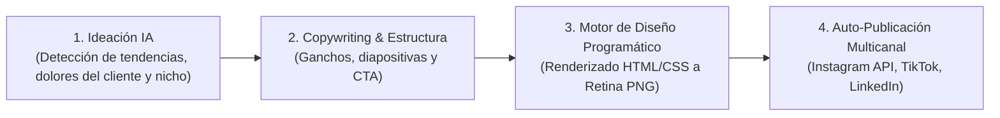

# Servicio Comercial: Carruseles Autónomos en Redes Sociales con IA (Piloto Automático)

> **Estado:** Idea / Propuesta de Servicio B2B  
> **Fecha de registro:** 2 de octubre de 2026  
> **Proyecto:** PAI Systems / PEBAI  
> **Infraestructura técnica base:** [`carousel-engine/`](file:///c:/programacion/emprendimiento/PAI%20Systems/carousel-engine/)

---

## 1. Concepto del Servicio

Servicio *llave en mano* de **generación y publicación 100% automatizada de carruseles de alta estética para redes sociales**.

A diferencia del mercado saturado de vídeos automáticos genéricos (vídeos faceless o avatares robóticos), este servicio se enfoca exclusivamente en **carruseles visuales de última generación**: un formato con altísima retención, tasa de guardados y compartidos, pero sin el esfuerzo ni la fricción de producción que exige el vídeo.

### Premisa Fundamental: "Zero-Touch" (Cero Intervención Humana)
El cliente no tiene que pensar temas, ni redactar copys, ni diseñar diapositivas, ni programar publicaciones en herramientas externas. **La IA realiza todo el ciclo de principio a fin.**

---

## 2. Diferenciadores Clave

1. **Diseño Ultra-Moderno y Calidad Visual Superior:**
   - Nada de plantillas genéricas de Canva vistas mil veces.
   - Diseños con estética contemporánea, tipografías premium (ej. Manrope, fuentes suizas), micro-texturas (mineral white, papel realista, trazos orgánicos) y renderizado en resolución Retina (1080 × 1440 px).
2. **Volumen Escalable sin Límite:**
   - La empresa puede publicar la cantidad que desee al día (1, 2, 3 o más carruseles diarios) sin costes adicionales de mano de obra.
3. **Multiplataforma Nativa:**
   - Publicación directa en **Instagram** (Carrusel Feed), **TikTok** (Photo Mode / Carrusel deslizante de fotos, formato viral prioritario del algoritmo) y **LinkedIn** (Documentos PDF/Carruseles corporativos).

---

## 3. Pipeline de Automatización End-to-End

1. **Ideación Autónoma:** Modelos de lenguaje analizan el sector de la empresa, noticias, dudas comunes y contenido de alto rendimiento para seleccionar temas ganadores.
2. **Copywriting & Storytelling:** Genera la portada de gancho, las diapositivas intermedias de valor y la llamada a la acción final con el pie de foto (`caption`) y hashtags optimizados.
3. **Renderizado Programático:** Utiliza el motor basado en código (similar al `carousel-engine` propio) para exportar diapositivas en segundos con precisión milimétrica.
4. **Publicación Automática:** Conexión vía API para subir las imágenes y programar la publicación sin intervención humana.

---

## 4. Modelo de Monetización (Pricing)

- **Planes de Suscripción Mensual (MRR):**
  - **Plan Crecimiento:** 1 carrusel diario (30 carruseles al mes) 100% automático.
  - **Plan Dominio / Escala:** 2 a 3 carruseles diarios (60 - 90 carruseles al mes) multi-red.
- **Cuota de Onboarding / Setup Inicial:**
  - Configuración inicial del libro de marca del cliente (paleta de colores, tipografías, logotipos vectoriales, tono de voz y credenciales de redes).
- **Margen Operativo:**
  - Prácticamente el 90%+ del coste es margen bruto, ya que el coste marginal por carrusel generado (tokens de LLM + segundos de CPU/Playwright) es de céntimos.

---

## 5. Próximos Pasos para Desarrollo

1. Adaptar el motor `carousel-engine/` para permitir inyección de marcas y estilos de clientes externos vía configuración JSON/DB.
2. Añadir el módulo de autodespacho / auto-upload a redes mediante API oficial de Meta Graph y TikTok / Make / n8n.
3. Diseñar landing y demo visual interactiva en la web para vender el servicio.
